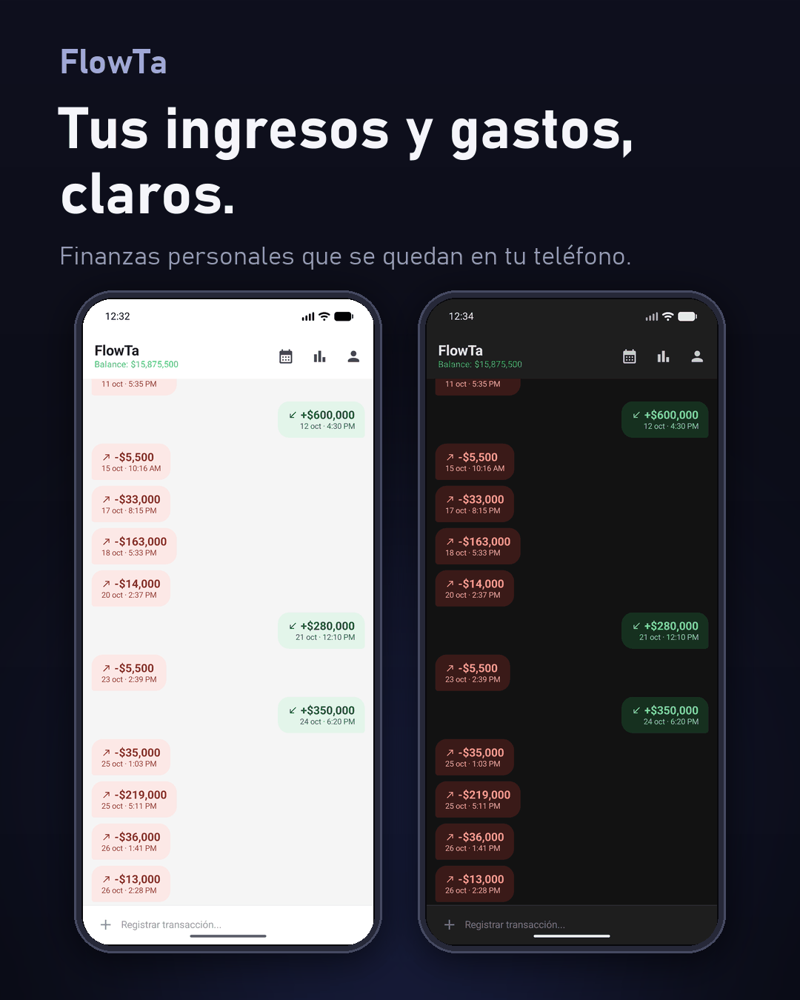
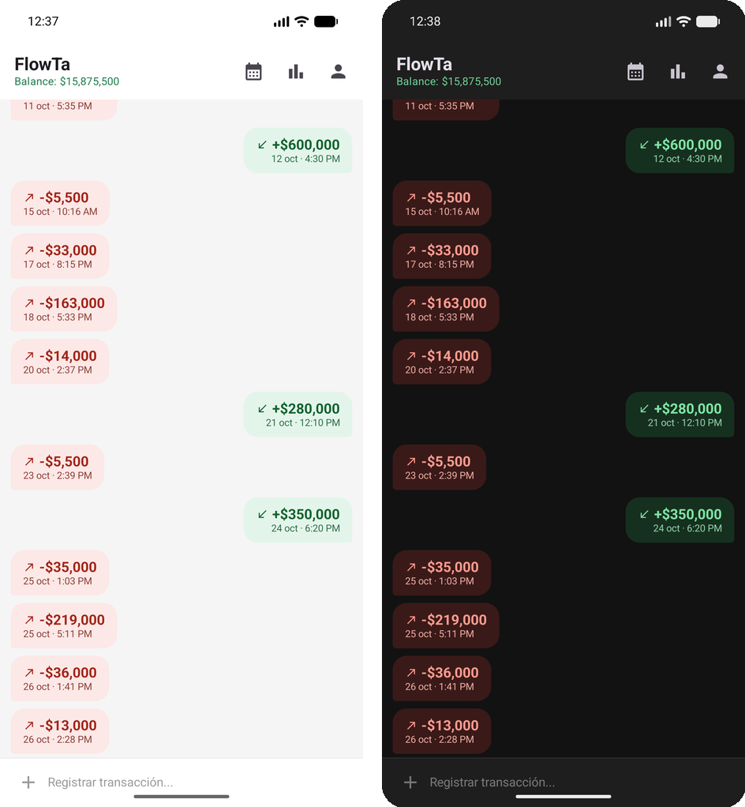
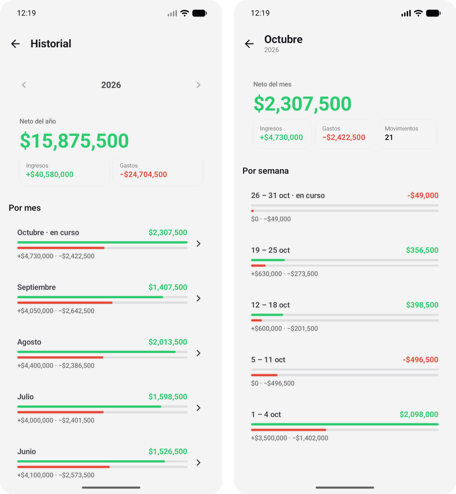
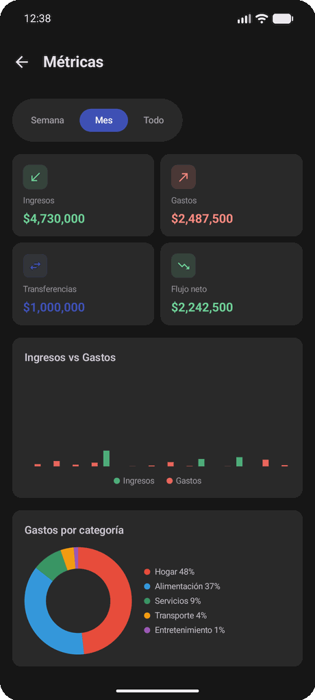
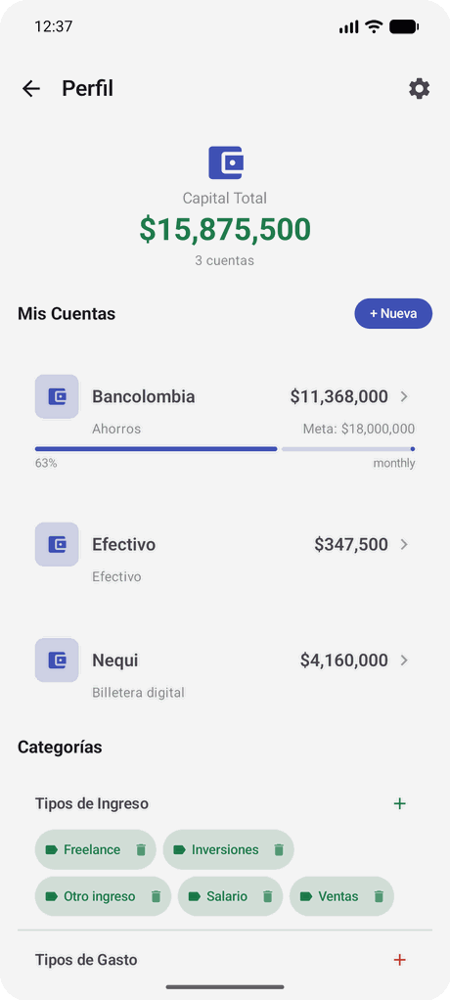
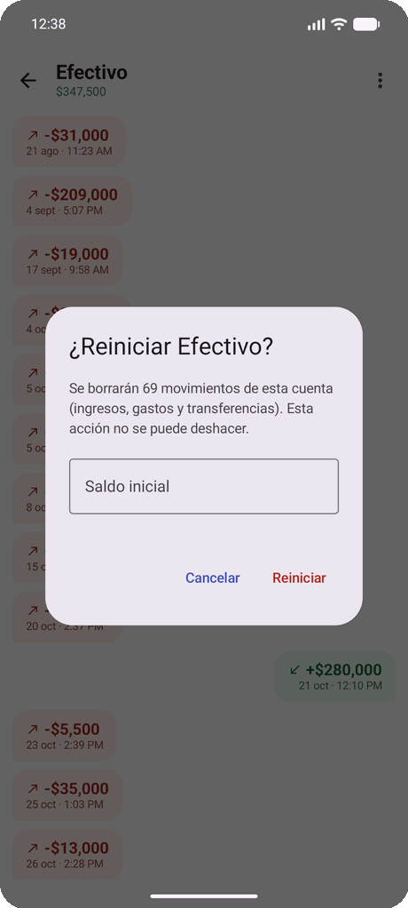

# FlowTa

**Tus ingresos y gastos, claros.** FlowTa es una app Android de finanzas personales con una interfaz de chat: cada movimiento es una burbuja, los ingresos a la derecha en verde y los gastos a la izquierda en rojo. Registrar algo toma unos toques y todos los datos se quedan en el teléfono.



## Cómo instalar

FlowTa se distribuye desde las [releases de GitHub](https://github.com/J4x0-o2/FlowTa/releases/latest)
(versión actual **1.1.0**). Requiere Android 10 o superior. Descarga `FlowTa-<versión>.apk`, ábrelo y
permite la instalación desde esa fuente cuando Android lo pida; también puedes agregar la URL del
repositorio en [Obtainium](https://github.com/ImranR98/Obtainium) para recibir avisos de versiones nuevas.

Desde la 1.1.0 la app se firma con el mismo certificado que MiCuadre (necesario para la integración).
Si tienes instalada una versión firmada con otro certificado, Android no deja actualizarla encima.

## Novedades en 1.1.0

- **Integración con MiCuadre.** Las carreras que termines en [MiCuadre](https://github.com/J4x0-o2/Mi_Cuadre_App) entran solas como ingresos: eliges el tipo de ingreso y una cuenta para las carreras en efectivo y otra para las de transferencia. Reenviar una carrera nunca la duplica, y desde *Perfil › Apps conectadas* ves la conexión y puedes desconectarla.
- **Ícono temático.** El ícono es vectorial y se adapta a los colores del tema de Android 13 o superior.
- **Firma de release.** La app se firma con el mismo certificado que MiCuadre.

## Qué hace

- **Registro en burbujas.** Ingresos, gastos y transferencias entre cuentas desde una sola hoja con tres pestañas. Cada movimiento tiene categoría, nota opcional y, en los ingresos, una fuente.
- **Burbujas agrupadas.** Dos o más movimientos seguidos del mismo tipo se juntan en una sola burbuja con la cantidad (×N), el total, las categorías y el rango de fechas. Al tocarla se despliega y muestra cada movimiento.
- **Cuentas y metas de ahorro.** Efectivo, cuenta bancaria, billetera digital, ahorros u otra. Las cuentas de ahorros pueden tener una meta con barra de progreso. El saldo se actualiza con cada movimiento.
- **Métricas por día, semana, mes y año.** Períodos de calendario con flechas para ir hacia atrás:
  - *Día:* el neto del día.
  - *Semana:* neto con la variación frente a la semana anterior, ingresos y gastos, barras por día (al tocar un día se ve su ingreso y su gasto), gastos por categoría, promedio diario, día más caro y porcentaje de ahorro.
  - *Mes y año:* neto, anillo de ahorro, gráfico de gastos por categoría e ingresos por fuente.
  - Cada categoría conserva el mismo color en todas las vistas.
- **Historial por semana, mes y año.** Neto anual, desglose por mes y, al abrir un mes, desglose por semana (lunes a domingo). Cada tarjeta muestra ingresos, gastos y una barra con qué parte de lo ganado se gastó; si se gastó más de lo ganado, la barra se pone roja y dice por cuánto. Los límites se calculan con la fecha local del dispositivo.
- **Montos según la moneda.** El separador de miles aparece dentro del campo mientras escribes (`373929` → `373,929`). En COP, `5.000` y `5,000` significan cinco mil; al pegar un monto con decimales en COP se descartan los decimales, y en USD/EUR se reconocen formatos como `1,234.56` y `1.234,56`.
- **Reiniciar una cuenta.** Borra los movimientos de una cuenta y la deja con el saldo inicial que indiques.
- **Borrar todos los datos.** Desde Ajustes, con confirmación escribiendo `BORRAR`; la app queda como recién instalada.
- **Ajustes.** Tema claro u oscuro y moneda COP, USD o EUR.
- **Integración con MiCuadre.** MiCuadre puede registrar en FlowTa, como ingreso, cada carrera terminada. Al conectarla eliges el tipo de ingreso y una cuenta para las carreras en efectivo y otra para las de transferencia. Las apps conectadas se ven y se desconectan desde Perfil.
- **Sin conexión.** La app no declara permiso de internet; no hay cuentas de usuario ni servidores.

## Capturas





<table>
  <tr>
    <td align="center"><br><sub>Métricas del mes</sub></td>
    <td align="center"><br><sub>Capital total, cuentas y meta de ahorro</sub></td>
    <td align="center"><br><sub>Reiniciar una cuenta</sub></td>
  </tr>
</table>

Los datos de las capturas son de demostración.

## Stack técnico

| Área | Tecnología |
|------|------------|
| Lenguaje | Kotlin 2.0.0 |
| UI | Jetpack Compose con Material 3 (BOM 2024.09.00) y Navigation Compose |
| Inyección de dependencias | Hilt 2.51.1 |
| Base de datos | SQLDelight 2.0.2 (SQLite) |
| Preferencias | DataStore Preferences |
| Tareas en segundo plano | WorkManager |
| Asincronía | Coroutines y Flow |
| Pruebas | JUnit 4, MockK, Turbine y el driver SQLite de SQLDelight |
| Build | Android Gradle Plugin 8.5.0, KSP 2.0.0-1.0.24, Gradle 9.2.1 |
| Plataforma | `minSdk` 29, `targetSdk` y `compileSdk` 35, Java/Kotlin 17 |

Los gráficos de Métricas se dibujan con `Canvas` de Compose, sin librerías de gráficos.

> No actualizar AGP a 9.x: SQLDelight 2.x usa una API que AGP 9 eliminó.

## Arquitectura

Organización por funcionalidad (*feature-first*). Cada feature separa `domain`, `data` y `presentation`, y la presentación usa MVI manual: un `State` inmutable, `Intent` para las acciones del usuario y `Effect` para eventos de una sola vez (snackbars, navegación).

```
app/src/main/java/com/j4x/flowta/
├── FlowTaApp.kt, MainActivity.kt
├── core/
│   ├── data/            # base de datos, tiempo (DayTicker), WorkManager
│   ├── domain/          # modelos compartidos (moneda), contratos de tiempo y trabajo
│   ├── presentation/    # tema, navegación, componentes, formato y parseo de montos
│   └── receiver/        # BootReceiver
├── di/                  # módulos Hilt: base de datos, repositorios, tiempo, trabajo
└── feature/
    ├── accounts/        # cuentas, detalle, reinicio de cuenta
    ├── transactions/    # pantalla principal, registro y detalle de movimientos
    ├── transfers/       # transferencias entre cuentas
    ├── types/           # categorías de ingreso, gasto y transferencia
    ├── metrics/         # métricas y gráficos
    ├── history/         # historial semanal, mensual y anual
    ├── profile/         # perfil: capital total, cuentas y categorías
    ├── settings/        # tema, moneda, borrado de datos
    ├── integration/     # ingresos de apps hermanas (MiCuadre): provider, conexión, apps conectadas
    └── goals/           # metas de ahorro (dominio y datos; interfaz pendiente)
```

- Los casos de uso exponen un único método público (`operator fun invoke`).
- Los repositorios son interfaces de dominio con implementación en `data`; los mappers convierten filas de SQLDelight a modelos de dominio.
- Las hojas modales (`ModalBottomSheet`) son estado local de cada pantalla, no rutas de navegación.
- El historial y las métricas agrupan por fecha local en Kotlin (`HistoryAggregator`, `MetricsAggregator` y `MetricsPeriod`, dominio puro) y no en SQL.
- La agrupación de burbujas del inicio es una función pura (`groupFeed`) separada de la pantalla.
- Los colores de categorías se asignan por el orden de creación de las categorías, no por hash, para que nunca se repitan entre categorías (hasta 12) y sean estables entre pantallas.

## Compilar y ejecutar

Requisitos: Android Studio reciente (incluye el JDK 17 que usa el proyecto) y un dispositivo o emulador con Android 10 (API 29) o superior.

```bash
./gradlew assembleDebug          # genera app/build/outputs/apk/debug/app-debug.apk
./gradlew testDebugUnitTest      # pruebas unitarias
adb install -r app/build/outputs/apk/debug/app-debug.apk
```

En Windows usa `gradlew.bat` o ejecuta los comandos desde Git Bash. También puedes abrir la carpeta en Android Studio y ejecutar la configuración `app`.

**Cambios de esquema.** El esquema está versionado (versión 2, snapshots `app/src/main/sqldelight/databases/1.db` y `2.db`, migraciones en `app/src/main/sqldelight/migrations/`) y las migraciones se verifican con `./gradlew verifySqlDelightMigration`. Antes de tocar un `.sq`, sigue el procedimiento de la sección *Migraciones* de [`CLAUDE.md`](CLAUDE.md).

**Build de release.** El release se firma con la misma llave que MiCuadre, porque la integración usa un permiso de nivel `signature`. Configura en `local.properties` (no se versiona) `FLOWTA_KEYSTORE_FILE`, `FLOWTA_KEYSTORE_PASSWORD`, `FLOWTA_KEY_ALIAS` y `FLOWTA_KEY_PASSWORD`, o las variables de entorno del mismo nombre. Si no hay ninguna, el APK sale sin firmar; si solo hay algunas, `assembleRelease` falla antes de compilar y dice cuáles faltan.

**Nota para Windows.** El módulo `tools/sqlite-worker-shim` solo participa en el build (no va en el APK): evita que `sqlite-jdbc` intente extraer su librería nativa en `C:\Windows` cuando Gradle 9 ejecuta las tareas de SQLDelight. Los detalles están en `CLAUDE.md`.

## Datos y privacidad

Toda la información (cuentas, movimientos, categorías y preferencias) se guarda únicamente en el dispositivo, en una base SQLite y en DataStore. La app no pide permiso de internet, no envía datos a ningún servicio y no requiere registro. La integración con MiCuadre es local, entre apps del mismo teléfono: solo una app firmada con la misma llave puede registrar ingresos, y únicamente después de que la conectes. *Borrar todos los datos* en Ajustes elimina todo y restablece las preferencias.

## Estado y próximos pasos

La app es funcional: registro, cuentas, métricas, historial, reinicio y borrado de datos están implementados y cubiertos por pruebas unitarias.

- **Metas de ahorro:** el modelo de datos y los repositorios existen, pero la pantalla `GoalsScreen` es todavía un marcador de posición.
- **Integración con MiCuadre:** completa desde FlowTa 1.1.0 y MiCuadre 1.4.0, probada de punta a punta en emulador.
- **Pruebas instrumentadas:** no hay `androidTestImplementation` configurado.
