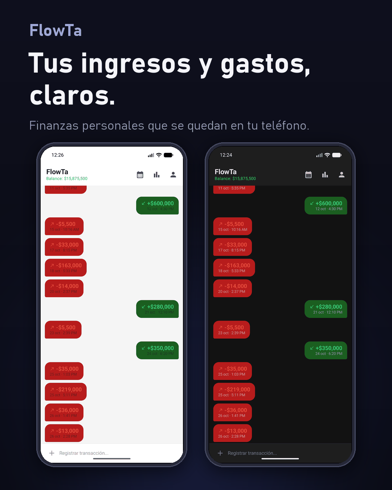
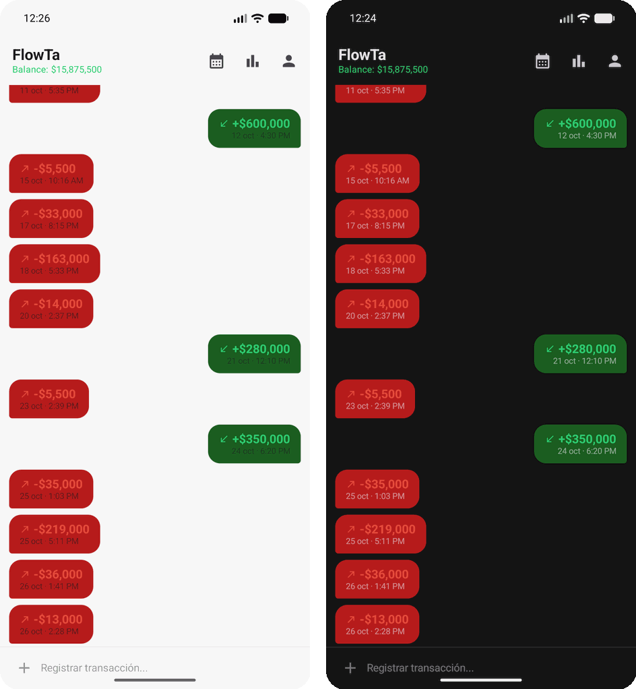
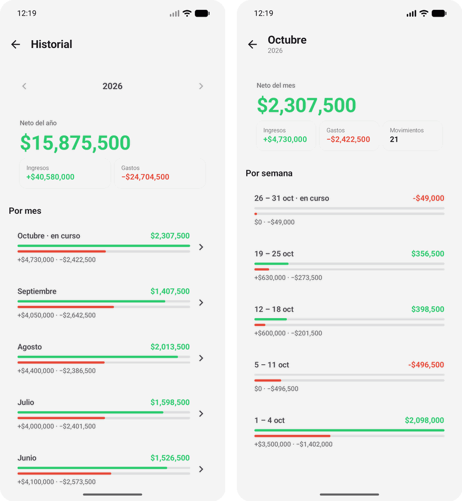
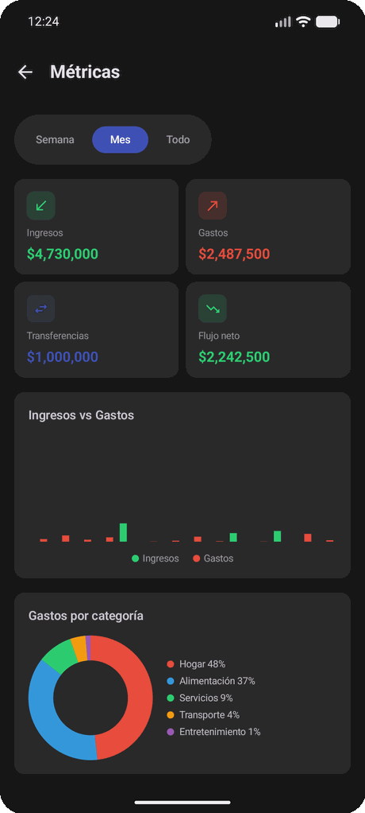
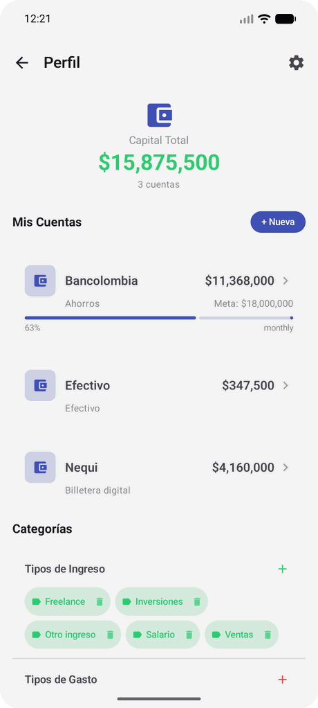
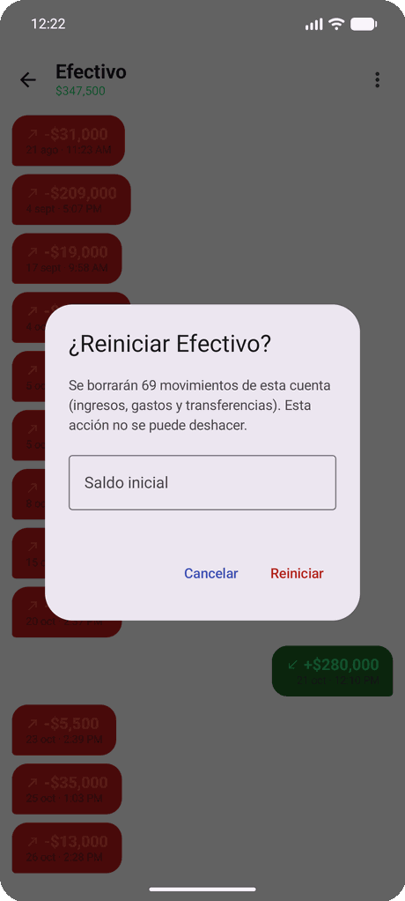

# FlowTa

**Tus ingresos y gastos, claros.** FlowTa es una app Android de finanzas personales con una interfaz de chat: cada movimiento es una burbuja, los ingresos a la derecha en verde y los gastos a la izquierda en rojo. Registrar algo toma unos toques y todos los datos se quedan en el teléfono.



## Qué hace

- **Registro en burbujas.** Ingresos, gastos y transferencias entre cuentas desde una sola hoja con tres pestañas. Cada movimiento tiene categoría, nota opcional y, en los ingresos, una fuente.
- **Cuentas y metas de ahorro.** Efectivo, cuenta bancaria, billetera digital, ahorros u otra. Las cuentas de ahorros pueden tener una meta con barra de progreso. El saldo se actualiza con cada movimiento.
- **Métricas.** Ingresos, gastos, transferencias y flujo neto por semana, mes o todo el tiempo, con gráfico de barras por día y gráfico de gastos por categoría.
- **Historial por semana, mes y año.** Neto anual, desglose por mes y, al abrir un mes, desglose por semana (lunes a domingo). Los límites se calculan con la fecha local del dispositivo.
- **Montos según la moneda.** En COP, `5.000` y `5,000` significan cinco mil; las entradas ambiguas se rechazan en lugar de interpretarse a ciegas.
- **Reiniciar una cuenta.** Borra los movimientos de una cuenta y la deja con el saldo inicial que indiques.
- **Borrar todos los datos.** Desde Ajustes, con confirmación escribiendo `BORRAR`; la app queda como recién instalada.
- **Ajustes.** Tema claro u oscuro y moneda COP, USD o EUR.
- **Sin conexión.** La app no declara permiso de internet; no hay cuentas de usuario ni servidores.

## Capturas





<table>
  <tr>
    <td align="center"><br><sub>Métricas del mes</sub></td>
    <td align="center"><br><sub>Capital total, cuentas y meta de ahorro</sub></td>
    <td align="center"><br><sub>Reiniciar una cuenta</sub></td>
  </tr>
</table>

Los datos de las capturas son de demostración.

## Stack técnico

| Área | Tecnología |
|------|------------|
| Lenguaje | Kotlin 2.0.0 |
| UI | Jetpack Compose con Material 3 (BOM 2024.09.00) y Navigation Compose |
| Inyección de dependencias | Hilt 2.51.1 |
| Base de datos | SQLDelight 2.0.2 (SQLite) |
| Preferencias | DataStore Preferences |
| Tareas en segundo plano | WorkManager |
| Asincronía | Coroutines y Flow |
| Pruebas | JUnit 4, MockK, Turbine y el driver SQLite de SQLDelight |
| Build | Android Gradle Plugin 8.5.0, KSP 2.0.0-1.0.24, Gradle 9.2.1 |
| Plataforma | `minSdk` 29, `targetSdk` y `compileSdk` 35, Java/Kotlin 17 |

Los gráficos de Métricas se dibujan con `Canvas` de Compose, sin librerías de gráficos.

> No actualizar AGP a 9.x: SQLDelight 2.x usa una API que AGP 9 eliminó.

## Arquitectura

Organización por funcionalidad (*feature-first*). Cada feature separa `domain`, `data` y `presentation`, y la presentación usa MVI manual: un `State` inmutable, `Intent` para las acciones del usuario y `Effect` para eventos de una sola vez (snackbars, navegación).

```
app/src/main/java/com/j4x/flowta/
├── FlowTaApp.kt, MainActivity.kt
├── core/
│   ├── data/            # base de datos, tiempo (DayTicker), WorkManager
│   ├── domain/          # modelos compartidos (moneda), contratos de tiempo y trabajo
│   ├── presentation/    # tema, navegación, componentes, formato y parseo de montos
│   └── receiver/        # BootReceiver
├── di/                  # módulos Hilt: base de datos, repositorios, tiempo, trabajo
└── feature/
    ├── accounts/        # cuentas, detalle, reinicio de cuenta
    ├── transactions/    # pantalla principal, registro y detalle de movimientos
    ├── transfers/       # transferencias entre cuentas
    ├── types/           # categorías de ingreso, gasto y transferencia
    ├── metrics/         # métricas y gráficos
    ├── history/         # historial semanal, mensual y anual
    ├── profile/         # perfil: capital total, cuentas y categorías
    ├── settings/        # tema, moneda, borrado de datos
    └── goals/           # metas de ahorro (dominio y datos; interfaz pendiente)
```

- Los casos de uso exponen un único método público (`operator fun invoke`).
- Los repositorios son interfaces de dominio con implementación en `data`; los mappers convierten filas de SQLDelight a modelos de dominio.
- Las hojas modales (`ModalBottomSheet`) son estado local de cada pantalla, no rutas de navegación.
- El historial agrupa por fecha local en Kotlin (`HistoryAggregator`, dominio puro) y no en SQL.

## Compilar y ejecutar

Requisitos: Android Studio reciente (incluye el JDK 17 que usa el proyecto) y un dispositivo o emulador con Android 10 (API 29) o superior.

```bash
./gradlew assembleDebug          # genera app/build/outputs/apk/debug/app-debug.apk
./gradlew testDebugUnitTest      # pruebas unitarias
adb install -r app/build/outputs/apk/debug/app-debug.apk
```

En Windows usa `gradlew.bat` o ejecuta los comandos desde Git Bash. También puedes abrir la carpeta en Android Studio y ejecutar la configuración `app`.

**Cambios de esquema.** El esquema está versionado (snapshot `app/src/main/sqldelight/databases/1.db`) y las migraciones se verifican con `./gradlew verifySqlDelightMigration`. Antes de tocar un `.sq`, sigue el procedimiento de la sección *Migraciones* de [`CLAUDE.md`](CLAUDE.md).

**Nota para Windows.** El módulo `tools/sqlite-worker-shim` solo participa en el build (no va en el APK): evita que `sqlite-jdbc` intente extraer su librería nativa en `C:\Windows` cuando Gradle 9 ejecuta las tareas de SQLDelight. Los detalles están en `CLAUDE.md`.

## Datos y privacidad

Toda la información (cuentas, movimientos, categorías y preferencias) se guarda únicamente en el dispositivo, en una base SQLite y en DataStore. La app no pide permiso de internet, no envía datos a ningún servicio y no requiere registro. *Borrar todos los datos* en Ajustes elimina todo y restablece las preferencias.

## Estado y próximos pasos

La app es funcional: registro, cuentas, métricas, historial, reinicio y borrado de datos están implementados y cubiertos por pruebas unitarias.

- **Metas de ahorro:** el modelo de datos y los repositorios existen, pero la pantalla `GoalsScreen` es todavía un marcador de posición.
- **Integración con MiCuadre:** está planificada y aún no se ha implementado.
- **Pruebas instrumentadas:** no hay `androidTestImplementation` configurado.
